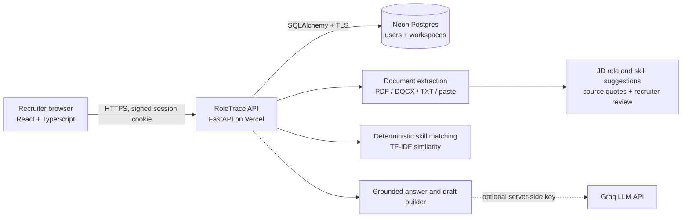

# RoleTrace — high-level design

**Version checked:** 7 November 2026. **Live app:** [roletrace.vercel.app](https://roletrace.vercel.app). This document describes the interview prototype.

## Purpose and boundaries

RoleTrace gives a recruiter one private workspace to add a job description (JD), add candidate CVs, compare them, inspect evidence, prepare interview questions, record a recruitment stage, draft emails, and ask questions about the supplied material. It makes an **ATS-style JD alignment** score for review. It does not decide whether to hire someone, send email, or verify a CV claim. Only synthetic data should be used in this demo.

## System view

The browser and API use the same public origin, so browser requests carry an HttpOnly session cookie. Vercel runs the Python API and serves the compiled React files. Postgres is the shared persistent store; app instances do not keep workspace data in their memory. The app works without an LLM key. If a server-side Groq key is configured, selected chat questions can use the model; invalid or unavailable model output falls back to the deterministic answer.

## Main request path

1. A recruiter registers or logs in. The API validates credentials against the `users` table and sets a signed cookie. The password is stored as an Argon2 hash.
2. An authenticated request loads **only** the `workspaces` row whose `user_id` matches the cookie's user. A new account receives an empty workspace. Sample people appear only if the recruiter adds the optional synthetic files, or if an older account still has legacy bundled samples.
3. The recruiter uploads or pastes a JD and CVs. The API extracts readable text into evidence chunks with a source and page, paragraph, or line location. Full extracted text stays in that user's Postgres workspace.
4. The API offers JD role and skill suggestions with source quotes. If several roles are present, the recruiter chooses one. The recruiter corrects categories, removes noise, adds missing skills, and saves a reviewed list. The app withholds comparison until that list includes at least one required or preferred skill. A ranked result then includes skill coverage, wording similarity, an alignment score, and excerpts supporting each found skill.
5. The browser shows cards, donut charts, bars, a skill evidence table, a summary, and interview questions. The recruiter can save a stage and assessment note for a candidate. Chat reads that saved record; before it exists, chat says the status is not recorded.
6. Draft generation creates a stored invitation or assessment message. The recruiter can edit, save, copy, or delete it. Sending happens outside RoleTrace.

## Data model

| Entity | Stored fields | Ownership and purpose |
| --- | --- | --- |
| `users` | Integer ID, normalized unique email, Argon2 password hash | One row per login account. |
| `workspaces` | `user_id` primary key and foreign key, JSON payload | Exactly one private workspace per user. |
| Workspace payload | JDs, CVs, selected JD ID, recruitment records, draft records | All reads and changes are scoped to the authenticated user. |
| JD | ID, title, selected role, reviewed requirements, review time/version, derived required/preferred skills, evidence chunks | One selected JD controls current ranking; review status gates scoring. |
| Candidate | ID, name, evidence chunks | Compared with the selected JD. |
| Recruitment record | Candidate ID, stage, assessment note | Saved by the recruiter, used in status chat answers. |
| Draft | ID, candidate ID/name, job title, kind, text | Editable message snapshot; no mail integration. |

The JSON workspace keeps this prototype small. For a production service, documents, stages, drafts, and audit events should have separate tables or object storage, with migration and concurrency controls.

## Matching and grounded responses

The JD parser uses role and section headings, local requirement wording, a shared term catalog, and short evidence-backed phrases. Its suggestions are editable drafts, not final requirements. A recruiter explicitly saves the list before comparison. An alternative such as AWS/GCP/Azure counts as one criterion; a CV mention of any option supports it. A skill counts as **found** when its name or alias appears in a CV evidence chunk; a small negation check avoids some false hits such as “no Python.” An absent mention means **no evidence found**, not a conclusion that the candidate lacks the skill.

For a JD with both skill categories, the score is:

`0.70 × required-skill coverage + 0.20 × preferred-skill coverage + 0.10 × TF-IDF cosine wording similarity`.

If one skill category is empty, its weight is redistributed among the remaining factors. Scores are rounded to whole percentages. The UI labels 80–100 as **Strong evidence match**, 55–79 as **Partial evidence match**, and below 55 as **Needs review**. The method is explainable but does not measure seniority, actual proficiency, or future performance.

Without Groq, chat uses computed matches, CV excerpts, saved recruitment records, and templates. It cites evidence for CV claims and says when a requested fact is not established. An optional Groq call receives selected document excerpts, a grounded-answer instruction, and the question. It must return recognized evidence IDs for candidate claims or the API uses the deterministic fallback. Do not use real candidate information with the optional external model in this demo.

## Separation, security, and deployment

- Every workspace, JD, CV, draft, recruitment update, comparison, and chat route loads data through the authenticated user. A resource ID from another account returns `404`; a request without a valid cookie returns `401`.
- The signed cookie is HttpOnly, SameSite=Lax, and Secure in production. Non-remembered sessions expire after 24 hours; remembered sessions after seven days. Logging out deletes the cookie.
- The backend enforces a 4 MiB limit per file or pasted document. The browser checks files before uploading. This fits beneath [Vercel's 4.5 MB function request-body limit](https://vercel.com/docs/functions/limitations); requests also carry multipart overhead.
- API responses return short evidence excerpts. Full extracted text stays in the database for matching and later questions. Large documents therefore do not automatically make every comparison response huge.
- Vercel hosts the public UI and API; Neon Postgres keeps accounts and workspaces across Vercel instances and restarts. `DATABASE_URL`, `SECRET_KEY`, and optional `GROQ_API_KEY` are server-side environment variables.
- The HTML entry page is served with `Cache-Control: no-store`. Compiled asset names include content hashes, and the build retains recent older assets so an open tab can refresh safely when a new release goes live.

**Concurrency limit:** independent accounts have separate rows and were tested with simultaneous writes. Two concurrent writes to the *same* account still update one JSON payload and can overwrite each other; this prototype has no optimistic version check. There is also no email verification, password reset, OCR, virus scanning, rate limiting, formal accessibility certification, or hiring bias validation. These are explicit production-hardening work, not demonstrated guarantees.

See [WORKING_SPEC.md](WORKING_SPEC.md) for exact user flows and API behavior, [QA_REPORT.md](QA_REPORT.md) for verification, and the root [README.md](../README.md) for setup.
