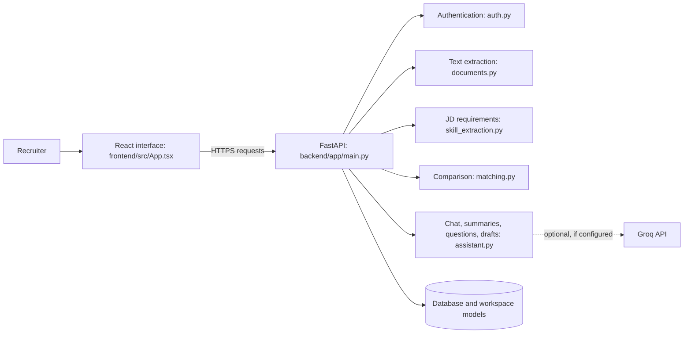

# RoleTrace: architecture and code-flow guide

This folder maps the RoleTrace source as it existed at commit `7814f09b` on 8 November 2026. Open [the interactive graph](graphify-out/graph.html), read [Graphify's report](graphify-out/GRAPH_REPORT.md), or use [the graph data](graphify-out/graph.json). The HTML loads its graph-drawing library from a public CDN, so the initial view requires an internet connection.

## What was analyzed

Graphify 0.9.104 used local, code-only structural extraction on 31 tracked Python, TypeScript and JavaScript source/test files. The graph has 327 nodes, 899 edges and 12 detected communities. Tests are included, so some highly connected nodes are test helpers rather than runtime components. Documentation, sample files, untracked files, credentials, uploaded documents, dependencies and generated frontend bundles were not scanned. Three files (`frontend/src/main.tsx`, `frontend/vite.config.ts`, and `frontend/vitest.config.ts`) produced no extracted symbols; they are not fully represented. No external model or API key was used for extraction.

Edges marked **EXTRACTED** are identified from source structure; **INFERRED** edges are Graphify's inferred links and need checking in the code. Automated links and community clusters are navigational aids, not proof that every runtime call occurs. The flow descriptions below were checked against the project documentation and source structure. For deployment details, use [the HLD](../docs/HLD.md); for the full user flow, see [the working specification](../docs/WORKING_SPEC.md).

## Big picture

The live prototype is hosted on Vercel and uses Neon PostgreSQL. Local development defaults to SQLite. The optional Groq arrow is not evidence that a key is configured in the live deployment; the last checked production settings did not have one.

## Code map

| Area | Main files | Responsibility |
| --- | --- | --- |
| Browser interface | `frontend/src/App.tsx`, `frontend/src/main.tsx` | Displays screens, accepts actions and calls the API. |
| Application and routes | `backend/app/main.py` | Creates the app; connects authenticated requests to workspace operations. |
| Accounts | `backend/app/auth.py` | Registration, login, password verification and session identity. |
| Storage and data shapes | `backend/app/models.py`, `backend/app/serializers.py` | Workspace records, data structures and response formatting. |
| Document reading | `backend/app/documents.py` | Extracts readable text and source evidence from uploads or pasted text. |
| JD skill suggestions | `backend/app/skill_extraction.py` | Analyzes role sections and wording to suggest requirements for review. |
| Candidate comparison | `backend/app/matching.py` | Checks skill evidence and calculates the alignment and wording similarity. |
| Recruiter assistance | `backend/app/assistant.py` | Creates summaries, questions, drafts and supported chat answers; optionally calls Groq. |
| Verification | `tests/`, `frontend/src/App.test.tsx` | Exercises API behavior, isolation, matching, concurrency and interface flows. |

## Follow a request from screen to answer

1. **Login:** the React interface submits credentials; FastAPI checks them through authentication code and establishes a signed session. Later workspace requests are tied to that user.
2. **Add a JD or CV:** the interface sends a file or pasted text to an API route. Document processing extracts text; the API saves the resulting document in the user's workspace.
3. **Review a JD:** skill extraction suggests requirements with supporting text. The recruiter edits and saves the list. Comparison requires a saved review with at least one scored requirement.
4. **Compare:** the API loads the selected JD and candidates, calls the matching logic and returns scores, matched skills and evidence. The frontend displays the results and charts.
5. **Inspect and prepare:** candidate analysis uses the matching result and source text to show evidence, a summary and suggested interview questions.
6. **Ask chat:** the API passes a question and workspace context to the assistant. Supported answers use the saved data and evidence; an optional Groq call is subject to the configured key and response checks, otherwise a fallback is used.
7. **Draft an email:** the assistant creates editable invitation or assessment text. Drafts are saved in the user's workspace; the application does not send email.
8. **Share deliberately:** a user can publish a snapshot to the authenticated shared library. Other users may view or import a separate copy; private workspace access remains scoped by account.

## Reading the graph

- Search for `create_app`, `Documents`, `rank`, `analyze_jd` or `answer` to find the relevant entry point.
- Select a node to inspect its neighbors and source file. A line denotes a detected relationship; it is not necessarily a chronological runtime sequence.
- `create_app()` is highly connected because it wires up API routes and is also exercised by tests. `workspace()` and `save_workspace()` relate to accessing and persisting per-user data.
- Graphify's community labels are automatic and generic. A cluster may mix runtime code and tests; use the code map above for an easier conceptual view.
- The report's suggested questions are prompts for investigation, not verified defects. In particular, an inferred link must be checked against the actual source.

## Regeneration and privacy

The source snapshot was deliberately staged from tracked source files into a temporary directory for the scan. To regenerate safely, create a fresh staging directory containing only the intended tracked source, then run Graphify's `extract <staging-directory> --code-only --out <output-directory>` and `cluster-only <output-directory> --no-label`. Do not scan local environment files, live databases, uploaded resumes, dependency folders or generated assets. Regeneration requires Graphify to be installed; this run used a temporary isolated Python environment, so that installation may not persist.

The graph is a static snapshot: it does not automatically update when code changes. It shows code structure, not real traffic, production configuration or verified model quality.
